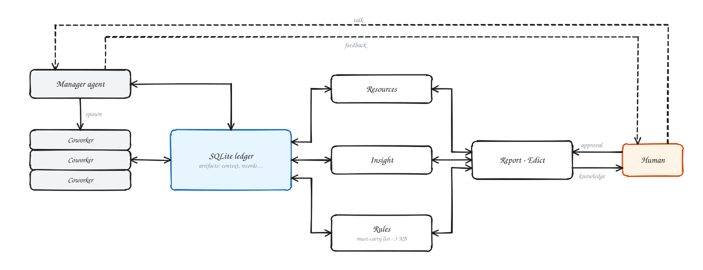

<div align="center">


# R²I

**Resources · Rules · Insight**

A research harness for the next generation of GenAI: AI threads submit memorials, you just sign the edicts.

Built on Claude Code + Obsidian · a sqlite ledger as the single source of truth · one prompt starts a new project

[](LICENSE)


[中文](README.zh-CN.md) | English

</div>

---



In a research project, AI can already read papers, write code, run experiments and write reports on its own. What still needs a human is **granting resources, laying down rules and bringing insight (setting direction, accepting conclusions)**. R²I turns that division of labour into a working harness. A set of Claude Code background threads work under the rules. Anything you must decide becomes a one-page "memorial" in your Obsidian vault, and a tick or a sentence from you is the edict. Everything else the threads decide, record and hand over themselves.

The stronger the AI gets, the less you have to manage. R²I is named after the only three things it aims to leave to a human: **Resources, Rules and Insight**.

The square has a second reading. In statistics, R² (the coefficient of determination) is the share of the variation that a model explains. Read yourself as the model and the project as the data: your R² is how much of what happened in the project you can explain. The more the agents do, the faster that number falls unless something holds it up. R²I's goal is to keep your R² close to 1, so that insight never drops out.

## Highlights

- **Edict-style interaction.** Threads do not chase you in chat. Anything you must decide becomes an approval page via `r2i ask` (question, options, recommendation, cost, evidence), pushed to your phone when ntfy is configured. You tick an option or write under "my answer" on the page, and the program hands your exact words back to the thread. Notifications during quiet hours are held until morning.
- **A research harness built for next-generation GenAI.** Threads are Claude Code background agents, opened, assigned and collected by one dispatcher session. Each thread has a `cc_…` identity, a department-named agent type, a handover page and a closing check. The stronger the models, the shorter the rules and the less a human has to step in.
- **Human–knowledge sync.** A sqlite ledger is the single source of truth for experiments, decisions, budgets, waits, ideas and hypotheses. Every minute a program renders it into Obsidian pages: home, approvals, syncs, progress, knowledge base and terminology. Humans read the vault, AI writes the ledger, and rendering never calls a model.
- **One persistent source for rules and CLAUDE.md.** The whole project has one rules page (vault `项目规则.md`) and one must-read checklist. `CLAUDE.md`, `AGENTS.md` and `GEMINI.md` are all generated from it and never edited by hand. Change sessions, models or people, and the rules neither get lost nor fork.
- **Nightly housekeeping.** You tick the night queue on your phone and it runs within the night budget. A night watchdog checks disks, the external disk and balances, and an hourly self-check catches budget mismatches, stuck queues and unanswered replies. Every night at 04:30 `r2i nightly run` drafts a repo tidy plan, "dreams" over yesterday's threads to propose memory changes, refreshes the terminology and writes the morning note.
- **New ideas, organised.** New ideas and hypotheses go into the ideas / hypotheses tables in the same turn, with audit status. Before any major pivot, a thread must first write "what we have tried".
- **Self-maintained handovers and memory.** A handover is one "current state" page. Threads are reminded to rewrite it before hitting the context limit, and a program check gates closing. Team memory holds only pointers and slow-changing conventions.
- **Gates on money, anything outward and deletion.** Every paid call goes through `r2i paid-run` (budget, cap, ledger), and keys live only in the system Keychain. Push, publish and delete accept only words you typed yourself in that thread.

## Start with one prompt

Make an empty directory, open a new Claude Code session in it, and paste:

```
Set up an R²I research project in this empty directory. First clone
https://github.com/Leozz04/R2I.git into tools/r2i, then read
tools/r2i/BOOTSTRAP.md and follow it from step 1 to step 8. Rules: do not make me run
terminal commands (except writing keys into the Keychain); ask all questions at once and only the
necessary ones; configure resources in one pass from docs/RESOURCES-SETUP.md; set up the rules
with me from scratch following docs/RULES-SETUP.md; ask me before creating remote repositories,
pushing, or sending anything outside.
```

An existing `CLAUDE.md` / `AGENTS.md` / `GEMINI.md` in the project is never dropped: `r2i entries` keeps it below the generated block and backs it up once as `*.pre-r2i`.

The agent checks dependencies, installs, and asks you only 4 things: project name, owner, time zone and first mainline. Then it runs `r2i init`, `r2i install` and `r2i doctor`, sends you a resource checklist to fill in once, sets up the rules with you from scratch, and opens the first thread. Apart from writing keys into the Keychain, you never touch a terminal.

## How it works


In the diagram, the coworkers are the Claude Code background threads, and Report · Edict is the vault pages where you read results and tick your decision.

| You manage | How |
|---|---|
| Resources | Configure once at install from the [resource checklist](docs/RESOURCES-SETUP.md); afterwards approve only spends above your line and the night budget |
| Rules | Following the [rules setup guide](docs/RULES-SETUP.md), write from scratch the list of "what I decide"; threads decide the rest and leave a one-line "done as X" |
| Insight | Read sync pages, progress pages and the knowledge base in the vault; important conclusions get a sync page opened by the program |

## What exists and what does not yet

Stated as it is: an automation is not described as running before it ships.

| Feature | Status |
|---|---|
| Ledger, approval pages, reply collection, thread layer, hooks, `r2i init` / `install` / `doctor` | Shipped (tested privately) |
| Spending gate `r2i paid-run`, code worker `r2i worker`, relay key isolation | Shipped |
| Night queue, night watchdog, hourly self-check | Shipped (launchd jobs) |
| Ideas / hypotheses tables, handover check | Shipped |
| Nightly run `r2i nightly run` (04:30 launchd job): repo tidy plan, memory "dreaming", terminology update, morning note, stale sync pages closed | Shipped; needs `[worker]` configured. Run end to end once on a toy project with a real model (claude-sonnet-5-5 via a relay, dry run, 4 worker calls, about 2.1 CNY, 3 min): repo plan, dream proposal, terminology page and morning note written; link and identifier self-check passed |
| Self-maintained memory | Partial: "dreaming" reads yesterday's threads and writes a proposal page each night; the memory itself is changed only after review (pointers only, local edits, stale facts rewritten) |

The vault pages, rule files and CLI messages are in Chinese; the English documents describe the same setup.

## What comes next

Planned, not built. R²I today is tuned for the current generation of models; as base models get stronger, these are the next steps.

1. **Dreaming that brainstorms, not just tidies.** The nightly "dream" pass should also:
   - collect garbage: archive and fold failed experiment branches in the `experiments` table that taught nothing;
   - cross-pollinate: compare results across mainlines, write new hypotheses into the `hypotheses` table, and put a ready-to-sign option in the morning edict, e.g. "Based on last night's 50 runs, drop plan 2 and test hypothesis X instead."
2. **Incubation mode.** For a new project or a big pivot, you and the manager agent talk in dense, many-turn exchanges (similar to [ARIS](https://github.com/wanshuiyin/Auto-claude-code-research-in-sleep)). Once you agree, one command converges the conversation into `goals`, `criteria` and `structures` rows in the ledger, and the project switches to the quiet edict mode.
3. **More base models, beyond the Claude Code CLI.** Rules already compile to `CLAUDE.md`, `AGENTS.md` and `GEMINI.md`. Next: threads and workers on other base models and agent runtimes, all on the same ledger.
4. **Fewer edicts as models improve.** The list of "what I decide" should shrink with model capability: fewer approval pages, shorter reports. The ledger keeps everything for audit.

## Docs

- [BOOTSTRAP.md](BOOTSTRAP.md): the 8 steps the bootstrap session follows
- [docs/RULES-SETUP.md](docs/RULES-SETUP.md): rules setup guide
- [docs/RESOURCES-SETUP.md](docs/RESOURCES-SETUP.md): resource install checklist
- [docs/ARCHITECTURE.md](docs/ARCHITECTURE.md): the manager, the ledger and the five mechanisms, one diagram each
- [docs/REFERENCE.md](docs/REFERENCE.md): full command and config reference

## Requirements

macOS (launchd, Keychain) · Python 3.11+ · git · Claude Code · Obsidian (recommended; the vault is a plain Markdown folder)

## License

[MIT](LICENSE)
