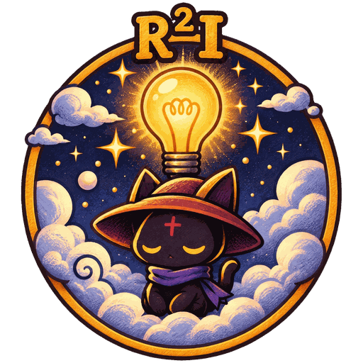
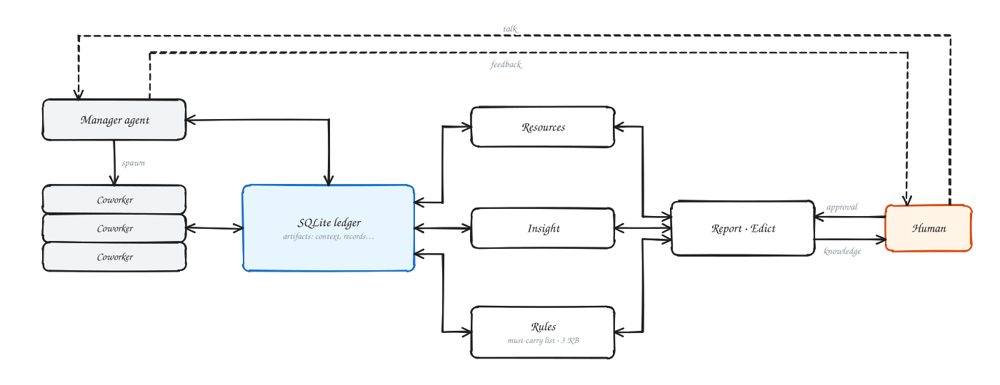
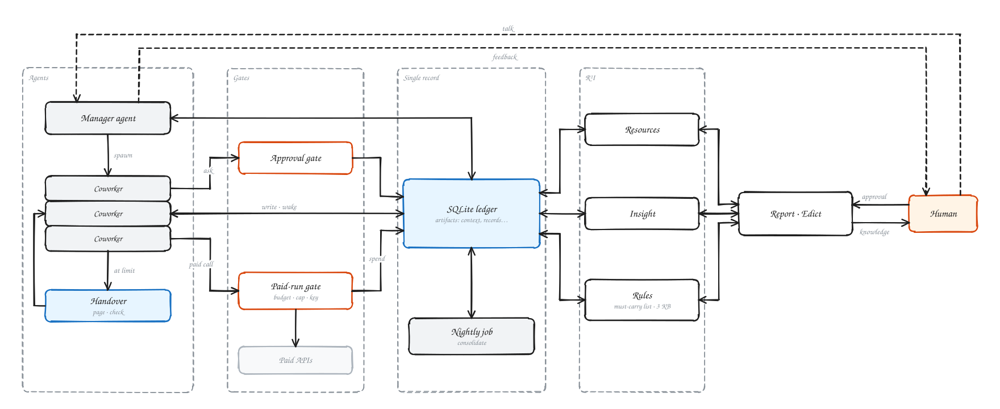

<div align="center">



# R²I

**Resources · Rules · Insight（资源 · 规则 · 洞见）**

给下一代生成式 AI 用的研究 harness：AI 线程上奏，你只批奏折。

基于 Claude Code + Obsidian · sqlite 台账做事实正本 · 一段 prompt 起一个新项目

[](LICENSE)


中文 | [English](README.md)

</div>

---



在一个研究项目里，AI 已经能自己读论文、写代码、跑实验、写报告。剩下真正需要人做的，是**给资源、立规矩、出洞见（定方向、认结论）**。R²I 把这种分工做成一个能直接用的 harness：一组 Claude Code 后台线程在规则下干活；要你定的事写成一页「奏折」放进你的 Obsidian，你勾一下、写一句就算批了。其余的事由线程自己定、自己记账、自己交接。

AI 越强，你要管的越少。R²I 的名字就是它想留给人的三样东西：**Resources 资源、Rules 规则、Insight 洞见**。

那个平方还有第二层意思。统计里的 R²（决定系数）衡量一个模型能解释数据中多少比例的变化。把你看作模型、把项目看作数据，你的 R² 就是你能解释项目里发生的事情的程度。agent 干的活越多，这个数掉得越快，除非有东西把它托住。R²I 的目标，就是让你对项目的 R² 保持接近 1：Insight 不掉线。

## 亮点

- **批奏折式交互。** 线程不在聊天里追着你问。要你定的事用 `r2i ask` 开一页要批页（问题、选项、推荐、花费、依据），配了 ntfy 时推到手机。你在页上勾选，或者在「我的回答」里写字，程序把你的原话交回给那条线程。静默时段的通知自动压到早上一起发。
- **为下一代 GenAI 设计的 research harness。** 线程是 Claude Code 后台 agent，由一个调度者会话负责开线程、派活、收汇报。每条线程有 `cc_…` 身份、带部门名的 agent 类型、交接页和结案检查。模型越强，规则越短，人介入得越少。
- **Human–knowledge sync。** sqlite 台账是唯一的事实正本，记实验、决定、预算、等待、想法和假设。程序每分钟把它渲染成 Obsidian 页面：首页、要批、同步、进度、知识库、术语表。人看 vault，AI 写台账，渲染过程从不调用模型。
- **规则和 CLAUDE.md 只有一个持久化正本。** 全项目只有一份规则（vault 里的 `项目规则.md`）和一页必带清单。`CLAUDE.md`、`AGENTS.md`、`GEMINI.md` 都由程序从正本生成，不手改。换会话、换模型、换人，规则都不会丢，也不会分叉。
- **夜间自动整理。** 夜间队列由你在手机上勾选、按夜间预算放行；夜间巡检看磁盘、外置盘和余额；每小时自检查预算对不上、队列卡住、回复没人收这类问题。每晚 04:30 `r2i nightly run` 出仓库整理方案、对前一天的线程「做梦」提记忆修改建议、更新术语表、写早报。
- **梳理新 idea。** 新想法、新假设当轮写进 ideas / hypotheses 表，带审计状态。大转向之前必须先写一节「我们试过什么」。
- **自维护的交接和 memory。** 交接是一页「现状」，快到上下文上限前提醒线程重写，结案前要过程序检查。团队记忆只放指针和变化慢的规矩。
- **花钱、对外、删除都有闸。** 付费调用一律走 `r2i paid-run`（预算、上限、记账），钥匙只放在系统钥匙串里。push、发布、删除这几类，只认你在那条线程里亲手打的字。

## 一句话开始

新建一个空目录，开一个新的 Claude Code 会话，粘进去：

```
在这个空目录里给我建一个 R²I 研究项目。先把 https://github.com/Leozz04/R2I.git 克隆到
tools/r2i，然后读 tools/r2i/BOOTSTRAP.zh-CN.md，照它从第 1 步做到第 8 步。规则：不要让我
在终端跑命令（往钥匙串写钥匙除外）；问题一次问完、只问必要的；资源按 docs/RESOURCES-SETUP.zh-CN.md 的清单
一次配；规则按 docs/RULES-SETUP.zh-CN.md 从零和我一起立；建远程仓库、push、对外发东西之前先问我。
```

项目里已有的 `CLAUDE.md` / `AGENTS.md` / `GEMINI.md` 不会丢：`r2i entries` 把它们原样留在生成段下面，并备份一次为 `*.pre-r2i`。

agent 会先查依赖、装好，只问你 4 件事：项目名、负责人、时区、第一条主线。然后依次跑 `r2i init`、`r2i install`、`r2i doctor`，发一张资源清单让你一次配好，再和你一起从零立规则，最后开出第一条线程。除了往钥匙串里写钥匙，你全程不用碰终端。

## 怎么运转



图里的 Coworker 就是 Claude Code 后台线程，Report · Edict 是 vault 里你读结果、勾批复的页面。

| 你管的 | 怎么管 |
|---|---|
| 资源 | 安装时照 [资源清单](docs/RESOURCES-SETUP.zh-CN.md) 一次配好；之后只批超过额度线的花费和夜间预算 |
| 规则 | 照 [规则设立指南](docs/RULES-SETUP.zh-CN.md) 从零定一张「我管哪几类事」的清单；其余的线程自己定，写一行「已按 X 做」 |
| 洞见 | 在 vault 里看同步页、进度页和知识库；重要结论由程序开同步页给你 |

## 现在有什么、还没有什么

照实写：自动化在上线之前，不说它已经在跑。

| 功能 | 状态 |
|---|---|
| 台账、要批页、回复收集、线程层、钩子、`r2i init` / `install` / `doctor` | 已有（已在私有仓库里测试） |
| 付费闸门 `r2i paid-run`、代码 worker `r2i worker`、中转站钥匙隔离 | 已有 |
| 夜间队列、夜间巡检、每小时自检 | 已有（launchd 定时任务） |
| ideas / hypotheses 表、交接检查 | 已有 |
| 夜间整理 `r2i nightly run`（04:30 定时）：仓库整理方案、记忆「做梦」、术语表更新、早报、超期同步页结档 | 已有；要配 `[worker]`。已在玩具项目上用真模型端到端跑过一次（经中转站的 claude-sonnet-5-5，演练模式，4 次 worker 调用，约 2.1 元，3 分钟）：仓库整理方案、做梦建议页、术语页、早报都生成，链接和编号自检通过 |
| 自维护 memory | 部分：每晚「做梦」读前一天的线程，写一页修改建议；记忆本身审过才改（只放指针、局部修改、过期改写） |

## 下一步设想

以下是计划，还没做。现在的 R²I 是按当前这一代模型调的；基础模型变强之后，下一步是这几件。

1. **做梦从整理升级为自我 brainstorm。** 夜间「做梦」还要做两件事：
   - 垃圾回收：把 `experiments` 表里失败、也没有价值的分支归档折叠；
   - 跨主线交叉：对比 A、B 两条主线的实验结果，主动在 `hypotheses` 表里写新假设，并在早报的奏折里直接给一个拍板选项，例如「基于昨晚 50 组实验，建议废弃原方案二，改测新假设 X」。
2. **孵化模式。** 新项目或大转向时，你和主 agent 高密度多轮对话（类似 [ARIS](https://github.com/wanshuiyin/Auto-claude-code-research-in-sleep)）。达成共识后，一条命令把对话收敛成台账里 `goals`、`criteria`、`structures` 表的记录，随后切回「批奏折」的静默执行模式。
3. **更多基础模型，不只跑在 Claude Code CLI 上。** 规则已经能生成 `CLAUDE.md`、`AGENTS.md`、`GEMINI.md`。下一步让线程和 worker 跑在别的基础模型和 agent 运行环境上，共用同一份台账。
4. **奏折随模型变强而减少。** 「我管哪几类事」的清单应随模型能力缩短：要批页更少，报告更短；台账照样全量留档，供审计。

## 文档

- [BOOTSTRAP.md](BOOTSTRAP.zh-CN.md)：引导会话照做的 8 步
- [docs/RULES-SETUP.md](docs/RULES-SETUP.zh-CN.md)：规则设立指南
- [docs/RESOURCES-SETUP.md](docs/RESOURCES-SETUP.zh-CN.md)：资源安装清单
- [docs/ARCHITECTURE.zh-CN.md](docs/ARCHITECTURE.zh-CN.md)：调度者、台账和五个机制，每块一张图
- [docs/REFERENCE.md](docs/REFERENCE.md)：命令和配置的完整说明（英文）

## 需要

macOS（launchd、钥匙串）· Python 3.11+ · git · Claude Code · Obsidian（推荐；vault 就是普通的 Markdown 文件夹）

## License

[MIT](LICENSE)
