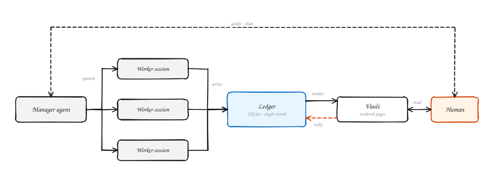
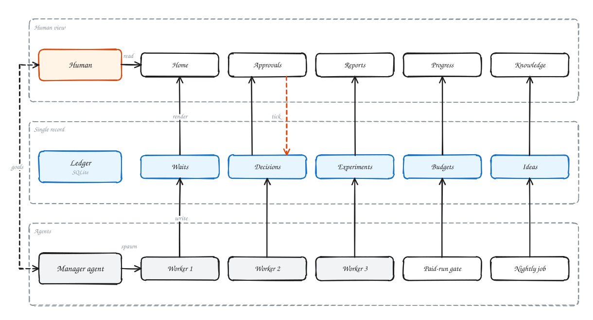
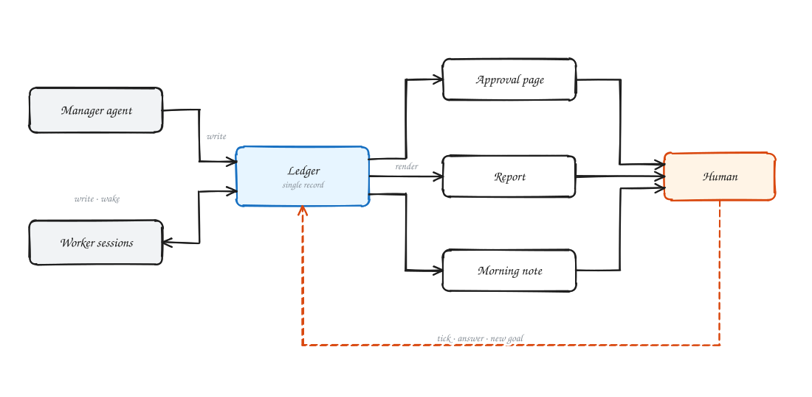
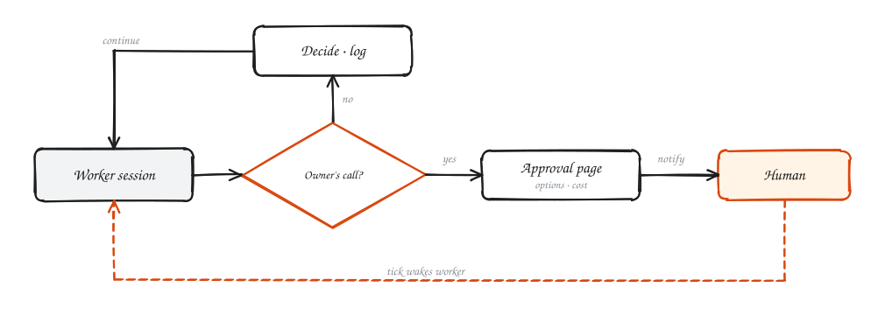
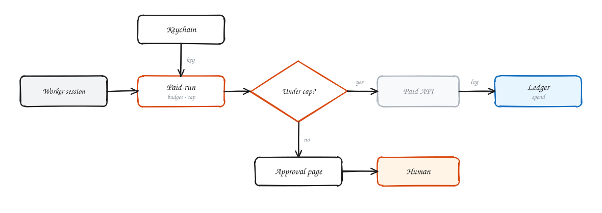
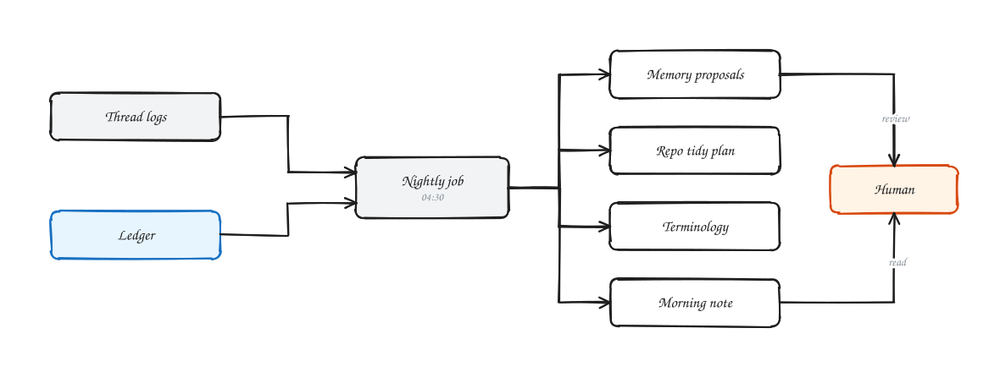
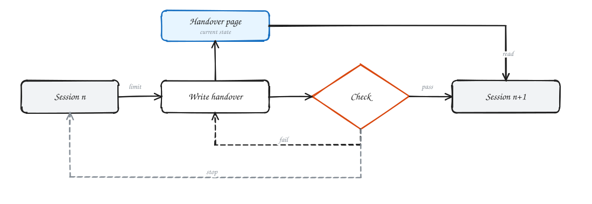
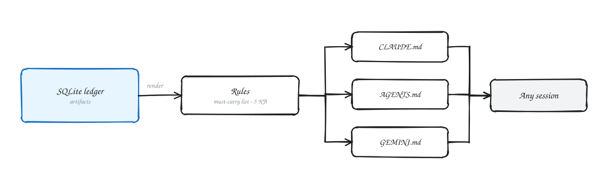

# Architecture

[中文](ARCHITECTURE.zh-CN.md) | English

The pieces behind the [overview](../README.md#how-it-works), one picture each. Commands are in [REFERENCE.md](REFERENCE.md).

## Manager, ledger and what you see

One dispatcher session opens and assigns the threads; the threads write the sqlite ledger; a program renders the ledger
into vault pages every minute; your ticks and answers go back into the ledger.

## Approval gate

Only the things on your "what I decide" list become an approval page (`r2i ask`); everything else a thread decides and
records in one line.

## Spending gate

Every paid call runs through `r2i paid-run`: a budget, a per-run cap, keys only from the Keychain, the spend in the ledger.

## Nightly run

`r2i nightly run` reads the day's threads and the ledger and writes a memory proposal, a repository plan, the
terminology pages and the morning note.

## Handover

At the context line a thread rewrites its handover page; after the handover check passes a new session takes over and
the old one stops.

## One source for the rules

The rules live in the ledger and are rendered into one must-carry list (about 3 KB); `r2i entries` generates CLAUDE.md,
AGENTS.md and GEMINI.md from it, so any session starts from the same rules.

