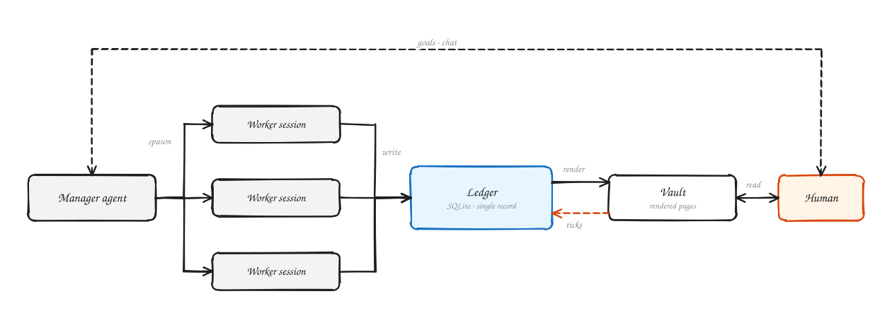
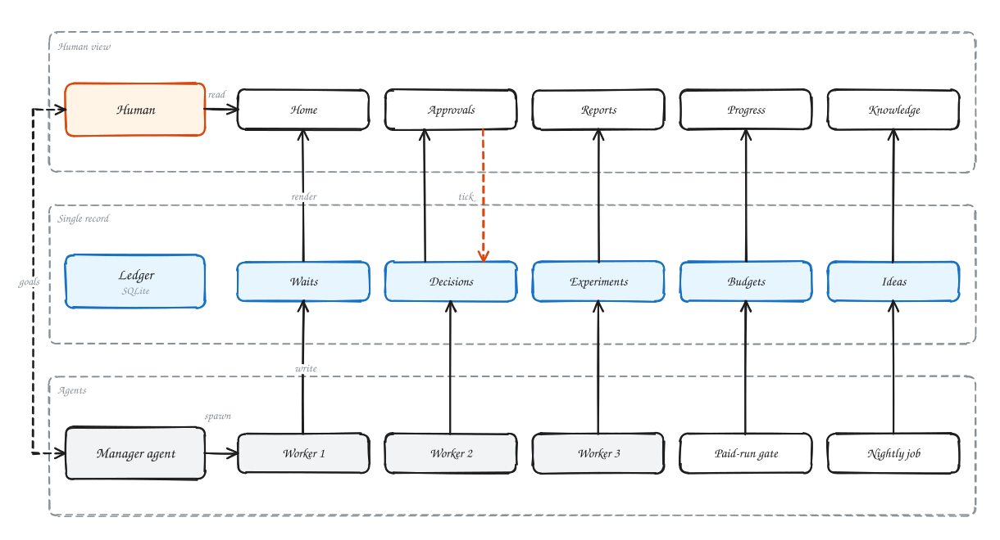
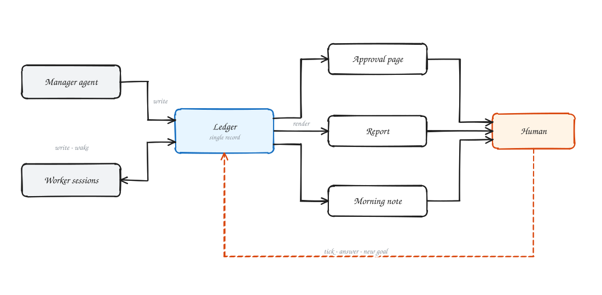
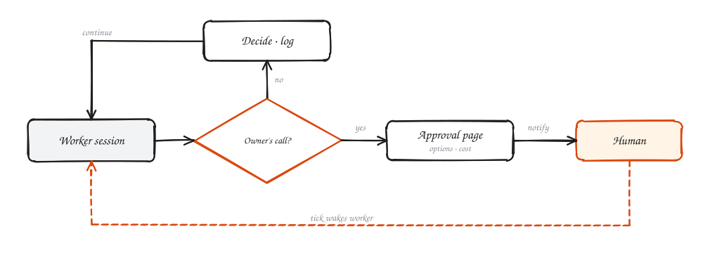
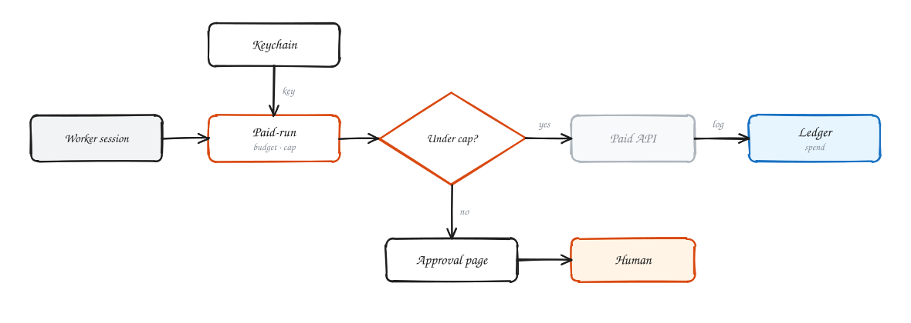
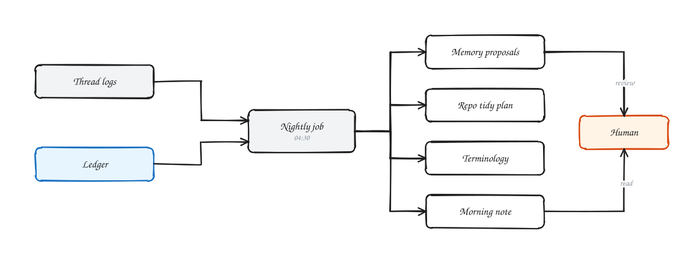
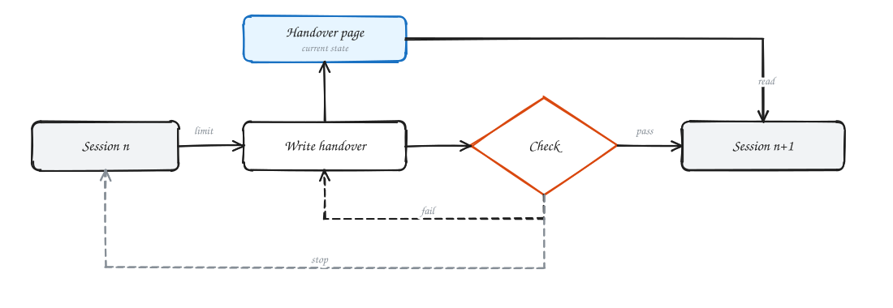
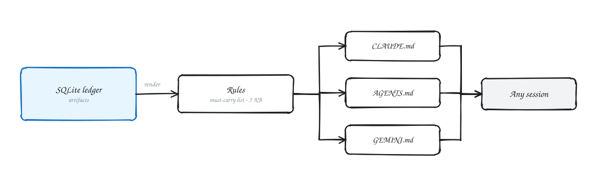

# 架构

中文 | [English](ARCHITECTURE.md)

[总览](../README.zh-CN.md#怎么运转)背后的几块，每块一张图。命令见 [REFERENCE.md](REFERENCE.md)。

## 调度者、台账和你看到的

一个调度者会话开线程、派活；线程写 sqlite 台账；程序每分钟把台账渲染成 vault 页面；你的勾选和回答回到台账。

## 要批闸门

只有「我来定」清单上的事才开要批页（`r2i ask`），其余由线程自己定，留一行记录。

## 花钱闸门

每笔付费调用都走 `r2i paid-run`：预算、单次上限、钥匙只从钥匙串取、花费记进台账。

## 夜间整理

`r2i nightly run` 读当天的线程和台账，写记忆建议、仓库整理方案、术语页和早报。

## 交接

到线时线程重写交接页；交接检查通过后新会话接手，旧会话停。

## 规则只有一份正本

规则在台账里，渲染成一份必带清单（约 3 KB）；`r2i entries` 从它生成 CLAUDE.md、AGENTS.md、GEMINI.md，任何会话都从同一套规则开工。

