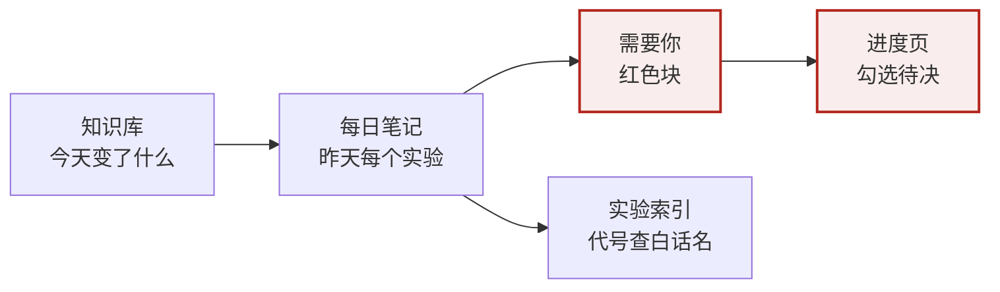

# 排版规范

> [!summary] 一句话
> 每页先给一条结论，再给证据。**粗体只给结论句，==高亮== 只给决定判断的数字，红色只给「需要你」**。其余保持黑白灰。所有往 vault 写东西的人和 agent 都按这页来，改规则先改这页。

样式文件是 `.obsidian/snippets/r2i.css`（颜色）和 `academic.css`（字号、宽度），模板在 [[agent/模板/知识库模板|模板/]]。这套规则借自 taste-skill 的「界面九成中性、强调靠对比、一种强调色、说人话」，改写成了笔记的版本。和它不同的地方写在最后一节。

## 1. {{owner}} 早上的阅读顺序

页面要为这条路径服务：一眼看到要做的事，然后看结论，需要时再往下读细节。



## 2. 强调分六级，每级有配额

从强到弱排。越强的越少，超过配额就降一级。

| 级 | 写法 | 用来标什么 | 配额 |
|---|---|---|---|
| 1 | `> [!owner] 需要你` | {{owner}} 要做或要拍板的事 | 有才写；一页一块，放在结论下面 |
| 2 | `> [!summary]` | 这一页的结论 | 每页一条，在最顶上 |
| 3 | `**粗体**` | 结论句，放在条目或段落开头 | 每段最多一处 |
| 4 | `==高亮==` | 决定判断的那个数字或对比，如 ==18/40== | 每块最多 2 处，每页最多 8 处 |
| 5 | 正常正文 | 解释、证据 | |
| 6 | 灰色（行内代码、引用块、属性） | 代号、日期、花费、来源链接 | |

不要做的：整句或整段加粗、整句高亮、给标题上色、彩色文字、用 emoji 做装饰、全大写、用斜体强调、callout 套 callout。

## 3. 颜色

界面九成以上是中性色。颜色只表达状态，同一个颜色在全 vault 只有一个意思。

| 颜色 | 意思 | 出现在 |
|---|---|---|
| 冷近黑 `#1d2420` | 正文 | 所有正文，不用纯黑 |
| 灰绿 `#5d6a63` | 元信息 | 代号、日期、花费、来源、表头 |
| 墨蓝 `#2f5f8a` | 结构 | 链接、`[!exp]` 实验块 |
| 警示红 `#a3291f` | **需要你** | 只有 `[!owner]` 和未勾的待决框 |
| 绿 | 正结果、发现 | `[!finding]` |
| 石板灰 | 负结果 | `[!negative]`。负结果不是坏事，所以不用红 |
| 琥珀 | 要当心 | `[!lesson]`、`[!term]`、`[!warning]` |
| 浅黄底 | 关键数字 | `==高亮==` |

不用紫色。底色是带一点绿的冷灰（浅色 `#f7f8f6`，深色 `#141917`）。深色模式下每个颜色都有对应的浅色版，写的时候不用管。

## 4. Callout 只有这几种

| 类型 | 标题怎么写 | 用在哪 |
|---|---|---|
| `[!summary]` | 一句话 | 每页最顶上，一到三句 |
| `[!owner]` | 需要你 | 待决、要 {{owner}} 跑的命令、要 {{owner}} 读的东西。每项一行，动词开头 |
| `[!finding]` | 发现 N：粗体结论 | 知识库的「跨主线发现」 |
| `[!negative]` | 负结果：粗体结论 | 改变了判断的负结果 |
| `[!lesson]` | 实战教训 | 跑真实数据后才暴露的问题 |
| `[!term]` | 术语提醒 | 发现旧名时，写「旧名 → 现名」 |
| `[!exp]` | `代号` 白话名 | 每日笔记里一个实验一块 |
| `[!superseded]-` | 已取代：原结论 | 被推翻的发现，默认折叠（类型后加 `-`） |
| `[!warning]` | 巡检告警 | 只给脚本用 |

不在表里的类型不要用。callout 里不再嵌套 callout。

## 5. 文字

- **结论先行**。每个条目、每个实验块的第一句是粗体结论，后面才是证据。
- **标题是名词**，说清楚是什么：「模块 B 的瓶颈在输入长度」，不写「一些思考」「进展」。
- **一句话一件事**，句子不超过 40 个字，段落不超过 4 行。
- **数字带单位和分母**：18/40、{{currency}} 1.23、15 分钟。表格必须有时间和花费两列。
- **代号首次出现要带白话名**：`CODE-01` 第一轮试跑（40 条）。同一页第二次出现可以只写代号。查不到白话名就去 [[实验索引]]。
- **术语用 `术语/` 里的现名**，第一次出现可以加中文。旧名不出现在正文里；如果引用的原文里有，就加一条 `[!term]`。
- 不夸大也不贬低结果，只把数字摆出来。
- 不写「本文档」「以下是」这类开场白，也不复制实验参数。

## 6. 表格

- 第一列是代号或日期，不换行。数字列右对齐（分隔行写 `---:`）。
- 表头用短名词，不超过 6 个字。
- 一张表不超过 7 列。超过就拆表，或者把说明挪到表下面。
- 单元格里不写长句。要解释就写在表下面，一行一条。
- 表里最关键的一格可以用 `==高亮==`，一张表最多两格。

## 7. 流程图

知识库每条主线一张「现在卡在哪」。其他页面有需要再画，一节最多一张。

- 方向：管线和时间顺序用 `flowchart LR`，判断分支用 `flowchart TD`。
- 每张不超过 12 个节点。节点名 2 到 8 个字，写结果而不是动作：「试跑 40 条」「通过 18/40」。
- 节点文字一律加双引号：`A["模块 B<br/>准确率 0.45"]`。不加引号时 `@`、括号、冒号等字符会让 Obsidian 报 Parse error。
- 不画「编排层」「AI 引擎」这种抽象节点，节点用实验里真实的东西命名。
- 状态用下面四个 classDef，名字和颜色固定，直接复制：

```text
  classDef pos fill:#2f7d4f1a,stroke:#2f7d4f
  classDef neg fill:#5b64701a,stroke:#5b6470
  classDef warn fill:#b7791f1a,stroke:#b7791f
  classDef owner fill:#b3261e14,stroke:#b3261e,stroke-width:2px
```

- `pos` 是正结果，`neg` 是负结果或已放弃的路线，`warn` 是瓶颈或风险，`owner` 是等 {{owner}} 决定的节点。没有状态的节点不加 class。
- 不写 `%%{init}%%`，主题交给 CSS，深色模式才能正常显示。
- 图下面不写图注，图上面的标题已经说明它是什么。

## 8. 各类页面

| 页面 | 文件 | cssclasses | 模板 | 谁写 |
|---|---|---|---|---|
| 统一知识库 | `知识库.md` | `[research]` | [[agent/模板/知识库模板]] | 整理 agent |
| 主线笔记 | `agent/主线/<名字>.md` | `[research]` | [[agent/模板/主线笔记模板]] | 整理 agent |
| 每日笔记 | `每日/YYYY-MM-DD.md` | `[research]` | 结构写在每日整理的提示词里 | 整理 agent |
| 实验索引 | `agent/实验索引.md` | `[wide, r2i-index]` | [[agent/模板/实验索引模板]] | 脚本 |
| 进度页 | `进度/<主线> 进度.md`、`进度/总览.md` | `[wide]` | [[agent/模板/进度页模板]] | 脚本 |
| 管理页 | `资源.md`、`agent/管理/` 下的脚本页 | `[wide]` | 同上 | 脚本 |
| 会前简报 | `会议/YYYY-MM-DD 会前简报.md` | `[reading]` | [[agent/模板/会前简报]] | 协调者 |
| 会议纪要 | `会议/` | `[reading]` | [[agent/模板/会议纪要]] | {{owner}} 或协调者 |

三种宽度在 `academic.css` 里定义：`reading` 40rem，适合长文；`research` 46rem，适合带表和流程图的页面；`wide` 72rem，适合脚本生成的大表。颜色、高亮和 callout 在 `r2i.css` 里定义。两个片段都要开着。

**文件名全库唯一**，否则关系图里会出现重名节点。新建文件前先搜一下有没有同名的。

### 选定的版式

| 页面 | 版式 | 要点 |
|---|---|---|
| 知识库 | A 卡片 | 跨主线发现用 `[!finding]` / `[!negative]`，主线一览用表 |
| 主线笔记 | B 清单 | 发现是编号列表，粗体结论在前，第二行写来源；已取代用删除线；只有一句话、术语提醒是 callout |
| 每日笔记 | A 卡片 | 每个实验一块 `[!exp]` |
| 进度页、总览 | C 表格 | 待决勾选 + 已决表 + 时间线表 + 验收表 |
| 实验索引 | C 表格 + 最近 7 天 | 顶部「最近 7 天」表，下面一张总表 |
| 会前简报 | B 清单 | 每个汇报重点一个小标题加三行（数字、改变了什么、限制），讨论问题是编号列表 |

## 9. 脚本生成的页面

- 只用这些写法：frontmatter、`##` 标题、列表、GFM 表格、`> 知识：[[…]] · 总览：[[进度/总览]]` 导航行、Tasks 勾选行、mermaid、`> [!warning]`、`> [!owner]`。
- 勾选行的格式一个字符都不能改：`- [ ] 问题 ^dec-NN`、`- [ ] … ^nq-YYYYMMDD-NN`、`- [ ] 等你回：<线程名>｜<问题> · [[线程]] ^wait-YYYYMMDD-NN`（线程名取 wait-add 的 `--editor`，一律写线程标题）。CSS 会把未勾的框画成红色，所以待决项不需要再包一层 `[!owner]`。
- 没变化时页面必须逐字节不变，所以不要写每次渲染都会变的时间戳。
- 进度页顶部放一条 `> [!summary]`，写验收 N/M 和待决数量，只用 frontmatter 里已经有的字段。

## 10. 写入前自检

- [ ] 最顶上有 `[!summary]`，读完它就知道这页的结论
- [ ] 需要 {{owner}} 的事都在一个 `[!owner]` 里，动词开头
- [ ] 每个条目第一句是粗体结论，每段最多一处粗体
- [ ] ==高亮== 每块不超过 2 处，而且高亮的是数字，不是句子
- [ ] 代号首次出现带白话名，没有旧名
- [ ] 表格有时间和花费，数字带单位和分母
- [ ] 流程图不超过 12 个节点，状态用四个固定 class
- [ ] 文件名全库唯一，cssclasses 按第 8 节填

## 11. 和 taste-skill 的不同之处

taste-skill 是做网站的规范。下面这几条照搬：界面九成中性、强调色只有一个、不用紫色、强调先靠粗细和灰度、标题用名词、说人话、一个元素一种样式、表格用细线分行、图下不写图注、图里的节点用真实名字。

有两处特意改了：

- **允许 ==高亮==。** taste-skill 不让给文字加底色，但笔记需要「高亮方便集中注意」。所以只给关键数字加，并且限了配额。
- **允许状态色。** 笔记有正结果、负结果、风险、等决定这几种状态，所以用四个固定颜色表示，每个颜色只有一个意思。
